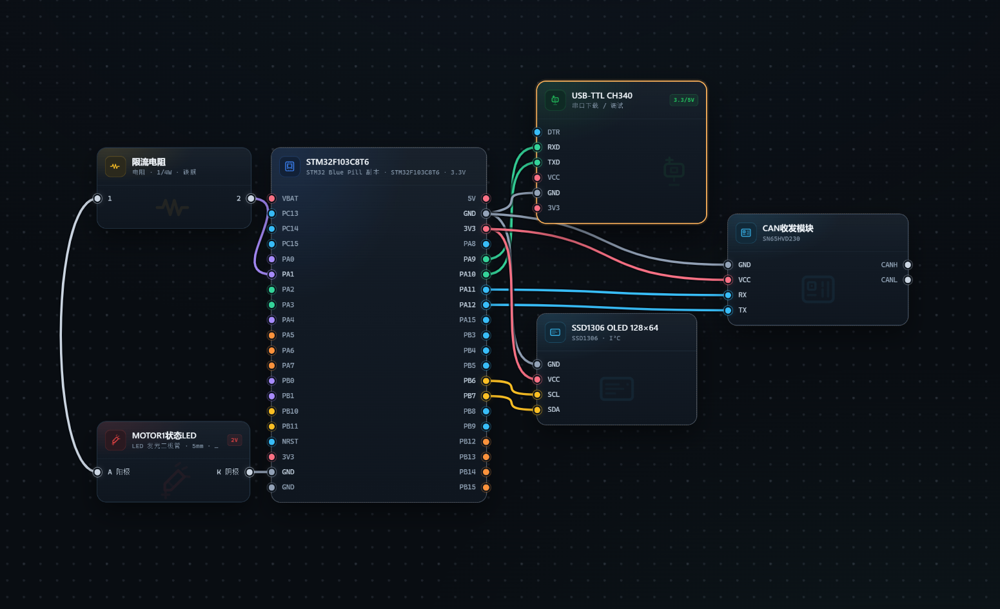
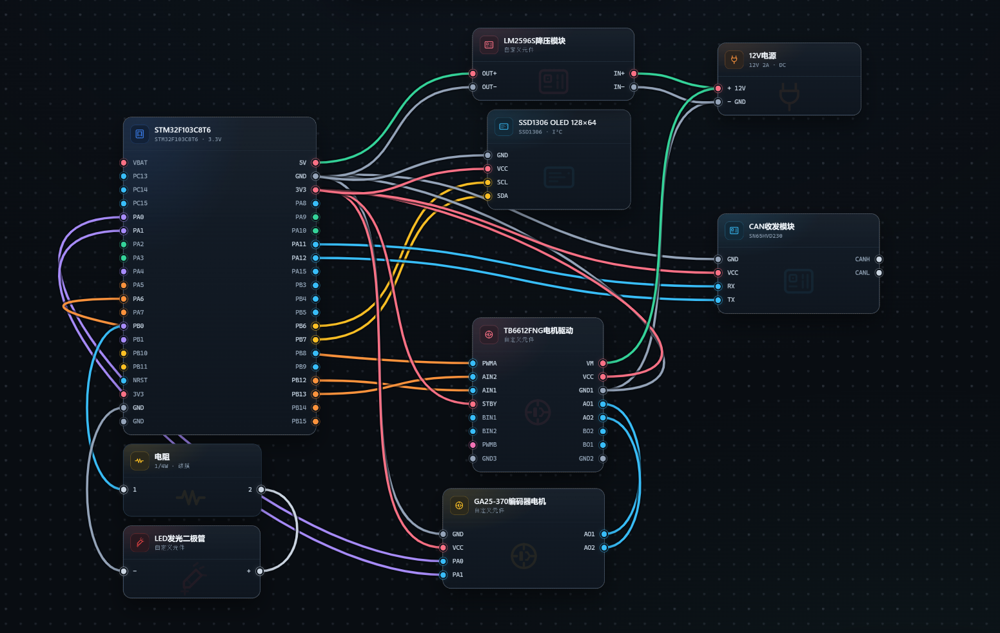

# 🚗 ${\color{purple}分布式闭环控制节点(DistributedClosedLoopControlNodes)}$
## 📕 项目简介
基于 **STM32F103C8T6** 的微型分布式实时控制系统。\
系统由 **主控节点（MASTER）** 和 **执行节点（Motor）** 组成，两者通过 **CAN 总线** 进行指令下发与状态回传。\
项目不仅实现了电机的高精度  **PID** 闭环调速，还引入了 **FreeRTOS** 操作系统进行多任务调度解耦，并设计了 **心跳检测与故障安全机制** 。\
此系统可进一步扩展成 **多执行节点** 网络，Master向多个Motor下发指令并接收Motor状态。
## 🛒 物料清单
BOM表
| 器件名称 | 数量 | 备注 |
|:------|:------:|:------|
| **ST-LINK V2** | x1 | ... |
| **USB-TTL CH340** | x2 | ... |
| **STM32F103C8T6** | x2 | ... |
| **GA25-370直流减速电机** | x1 | 12V; 58r/min; 减速比1:103; 带霍尔编码器 |
| **0.96寸OLED** | x2 | ... |
| **TB6612FNG电机驱动模块** | x1 | ... |
| **SN65HVD230 CAN通讯模块** | x2 | ... |
| **LM2596S DC-DC降压模块** | x1 | 12V->5V |
| **12V2A电源适配器** | x1 | 建议：DC头转XH2.54-2P  x1 |
| **限流电阻** | x2 | ... |
| **发光二极管** | x2 | ... |
| Makerbase CANable 2.0 S | x1（可选） | 非必须，仅调试用 |xian
## ⚡ 参考接线图
MASTER节点接线图

（1）Master串口接收VOFA+指令 -> 封装为CAN报文 -> 发送至总线；\
（2）接收总线状态 -> 解析CAN报文 -> 通过串口回传至VOFA+；

MOTOR节点接线图

（1）接收总线状态 -> 解析CAN报文 -> 执行Master指令；\
（2）获取当前电机状态 -> 封装为CAN报文 -> 发送至总线；\
（3）Motor串口接收VOFA+指令 -> 解析串口指令 -> 执行串口指令；

## ✨ 核心特性
- **分布式架构**：基于 CAN 总线自定义协议，实现主从节点双向通信。
- **高精度控制**：位置式 PID 算法，实现带有死区控制、抗积分饱和的平滑调速。
- **多任务实时调度**：基于 FreeRTOS 实现任务解耦，使用 vTaskDelayUntil 严格保证控制周期。
- **工业级安全保护**：引入心跳包机制，通信超时自动触发警报。
